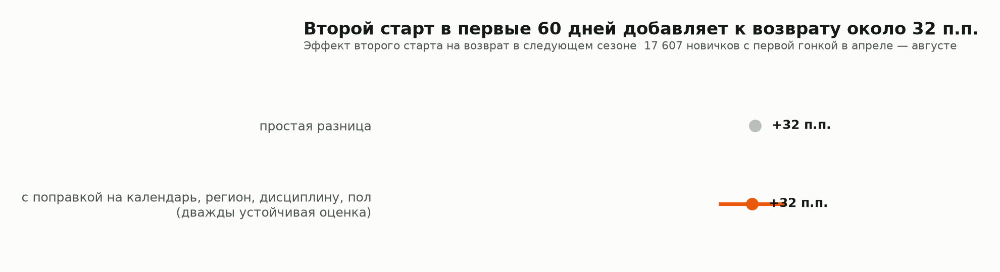
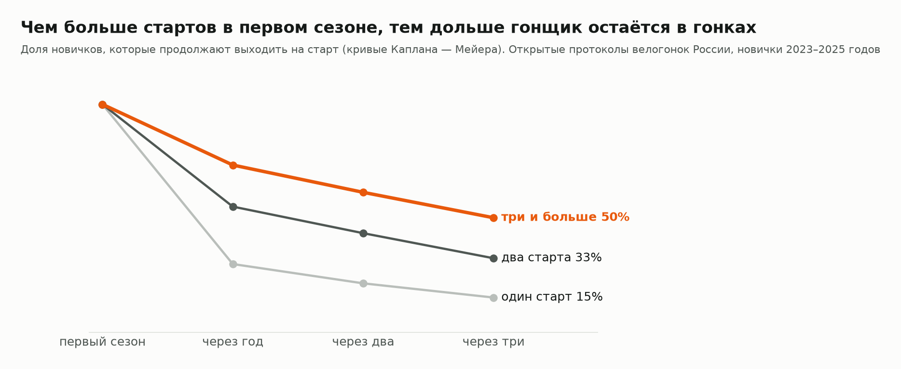

# Велогонки России: что удерживает гонщиков

> **Проект в работе.** Здесь показаны методы и обобщённая часть результатов. Полный анализ с выводами по регионам, организаторам и календарю я веду для собственного проекта — гравийной серии «Дядя Грэвел» — и не публикую.

Две трети новичков любительских велогонок на следующий сезон не возвращаются. Задача исследования — понять, от чего это зависит и на что может повлиять организатор.

**Данные:** открытые протоколы шести площадок за 2014–2026 годы — 241 691 старт, 58 369 гонщиков, 2 274 события из 51 региона. Основной анализ — 26 тыс. новичков 2023–2025 годов. Сборщики под каждую площадку написаны в проекте. Общего идентификатора у участника нет: гонщики сведены между источниками, для каждого восстановлена история стартов.

📊 [Интерактивный дашборд](https://oiltsar.github.io/russia-cycling-analytics/)

**Стек:** Python · pandas · scikit-learn · LightGBM · SHAP · lifelines · statsmodels · NetworkX · Plotly

**Автор идеи и исследования:** Александр Царегородский. Работа выросла из [анализа Русской гравийной серии](https://github.com/oiltsar/gravel-series-analytics). Код написан вместе с Claude Code.

## Что уже видно

**Второй старт — главный рычаг возврата.** С одним стартом в первом сезоне на следующий год возвращаются 24% новичков, с двумя и больше — 56%. С поправкой на календарь, регион, дисциплину, пол и размер гонки эффект второго старта в первые 60 дней — около +32 п.п. (95% интервал 29–35 п.п., 17 607 новичков).



Это оценка по наблюдениям, а не эксперимент: скрытую мотивацию гонщика убрать нельзя, настоящий эффект меньше.

**Эффект держится годами.** Через три сезона на старт выходят 15% тех, кто начал с одного старта, и 50% тех, кто начал с трёх и больше.



**Гонки России — это острова.** Сеть из 264 серий распадается на 23 сообщества почти без общих участников (модулярность 0,81). Сеть можно посмотреть на дашборде.

## Методы

| Задача | Метод | Код |
|---|---|---|
| Собрать протоколы с площадок без общего формата | сборщики под открытые JSON-запросы и HTML-страницы, паузы и докачка | [sources/](src/deep/sources) |
| Свести гонщиков из шести источников, убрать дубли стартов и событий | нормализация имён, правила приоритета источников, пол по имени (точность 99,8% на размеченной части) | [base.py](src/deep/base.py), [merge.py](src/deep/sources/merge.py) |
| Описать календарь вокруг первой гонки каждого новичка | признаки по событиям региона и дисциплины | [features.py](src/deep/features.py) |
| Оценить причинный эффект второго старта | дважды устойчивая оценка (AIPW) с перекрёстной подгонкой на градиентном бустинге | [causal.py](src/deep/causal.py) |
| Найти факторы возврата | LightGBM и SHAP, ROC-AUC 0,75 | [analyze.py](src/deep/analyze.py) |
| Сравнить группы по удержанию | кривые Каплана — Мейера | [analyze.py](src/deep/analyze.py) |
| Сравнить серии с разным числом новичков | эмпирический Байес, бета-биномиальное сглаживание | [analyze.py](src/deep/analyze.py) |
| Найти структуру рынка | сеть совместного участия, сообщества Лувена | [analyze.py](src/deep/analyze.py) |
| Оценить потенциал регионов | регрессия числа гонок по населению, отклонение от ожидаемого | [analyze.py](src/deep/analyze.py) |

Инструментальная оценка эффекта второго старта не получилась: инструмент оказался слабым. Результат оставлен в `out/results.json` как отрицательный.

## Что дальше

- Добрать регионы, где протоколы публикуют файлами, а не на площадках. Сейчас больше ста гонщиков набирается в 36 регионах; лучше всего покрыты Москва, Петербург, Приморье, Урал и Сибирь.
- Проверить эффект второго старта экспериментом в собственной серии.

## Что в репозитории

```
src/deep/     сборщики источников, сбор базы, признаки, причинный анализ, модели
out/          обезличенные таблицы для показанных результатов
figures/      графики
dashboard/    сборка интерактивной страницы
docs/         готовый дашборд (GitHub Pages)
```

Исходных протоколов в репозитории нет: в них имена участников.

## Ограничения

- Учтены только гонки с открытыми списками участников, все числа — нижняя граница.
- 2026 год неполный, по состоянию на начало ноября.
- После добавления двух источников оценки сдвинулись на 1–3 п.п., выводы не изменились: это проверка устойчивости, которую проект прошёл.
- Гонщики сведены по имени: возможны тёзки и разные написания.
